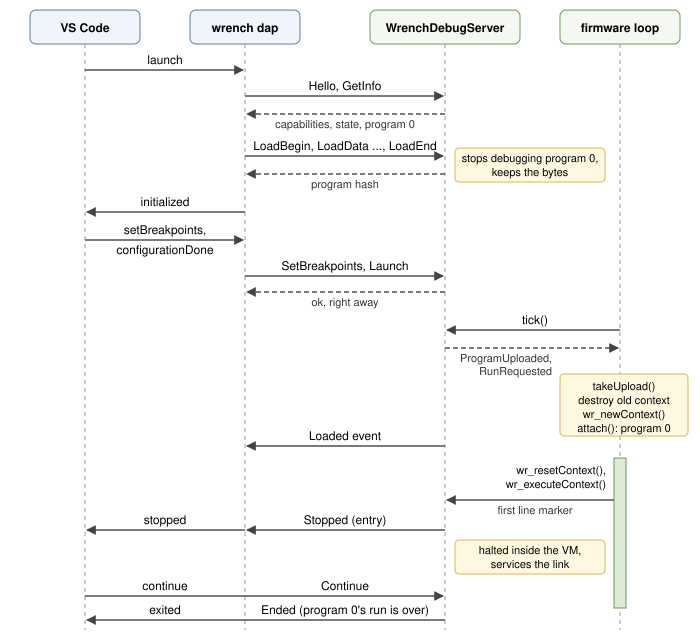

# Adding the debugger to your firmware

This page is for firmware and application developers: how to build wrench
with the debug server, create the server and its transport, hand it the
contexts your firmware runs, service it from the main loop, and let a
debugger launch and upload programs. It ends with writing a transport,
the memory the server costs, watchdogs, and the one rule about tasks. The
examples in `examples/debug_targets` do all of this for real boards; the
code here follows them.

## Building with the debug server

Define `WRENCH_INCLUDE_DEBUG_CODE` for every file that includes
`wrench.h`. The usual way is a `wrench_config.h` next to `wrench.h`, which
`wrench.h` picks up through `__has_include` (with a compiler that lacks
`__has_include`, pass the defines as compiler flags instead):

```cpp
// wrench_config.h, picked up automatically by wrench.h when it sits next to it

#define WRENCH_INCLUDE_DEBUG_CODE
#define WRENCH_DEBUG_MAX_PAYLOAD 512
```

These settings size the server. The defaults suit an ESP32; a small MCU
lowers the first three:

| Define | Default | What it sets |
|---|---|---|
| `WRENCH_DEBUG_MAX_PAYLOAD` | 1024 | the largest message either side sends; the server keeps two buffers of this size, the client adapts to the target's value |
| `WRENCH_DEBUG_MAX_BREAKPOINTS` | 32 | line breakpoints, over all programs |
| `WRENCH_DEBUG_MAX_HANDLES` | 64 | containers (arrays, hash tables, structs, strings) a debugger can expand per stop |
| `WRENCH_DEBUG_MAX_WATCHES` | 4 | watchpoints; each is checked at every line marker |
| `WRENCH_DEBUG_MAX_WATCH_STEPS` | 4 | how deep a watchpoint reaches into containers (`a[1].k` is two steps) |
| `WRENCH_DEBUG_MAX_PROGRAMS` | 4 | programs one server debugs: attached contexts and imported modules |
| `WRENCH_DEBUG_PROGRAM_NAME` | 24 | bytes kept of a name given to `attach()` |
| `WRENCH_DEBUG_MAX_IMPORT_CALLS` | 8 | nested calls into imported modules a call stack shows through |
| `WRENCH_DEBUG_POLL_MS` | 20 | how often the link is polled while script code runs |
| `WRENCH_DEBUG_POLL_LINES` | 8 | how many source lines pass between two reads of the clock |

A small MCU is fine with:

```cpp
#define WRENCH_DEBUG_MAX_PAYLOAD 128
#define WRENCH_DEBUG_MAX_BREAKPOINTS 8
#define WRENCH_DEBUG_MAX_HANDLES 16
```

All build flags are listed in [Build flags](../reference/build-flags.md).
The scripts themselves must be compiled with debug information, see
[Compiling for the debugger](overview.md#compiling-for-the-debugger).

## The server and a transport

A `WrenchDebugServer` belongs to one `WRState` and talks through one
`WrenchDebugTransport`:

```cpp
#include "wrench.h"
#include "blink.h" // wrench ch -debugsource script/blink.w blink.h blink

static WrenchDebugStreamTransport debugLink( Serial );
static WRState* w = 0;
static WrenchDebugServer* debugger = 0;

void setup()
{
	Serial.begin( 115200 );

	w = wr_newState();
	// register your natives here

	debugger = new WrenchDebugServer( w, &debugLink );
	// attach() and run the script, see below
}
```

The constructor allocates the server's state once, with `malloc` or the
allocator given to `wr_setGlobalAllocator()` (see [Memory](#memory)).
After that, breakpoints, stepping, pausing and inspecting values allocate
nothing. The server and the transport must live as long as the state and
its contexts. The ready-made transports are listed in
[Transports](targets.md#transports); writing your own is described
[below](#writing-a-transport).

## Handing over contexts: attach()

The server never runs script code and owns no context. Your firmware
creates a context, hands it to the server with `attach()`, and runs it as
it would without a debugger:

```cpp
WRContext* script = wr_newContext( w, blink_bytecode, blink_bytecodeSize );
debugger->attach( script, "blink.w" );
bool ready = script && wr_executeContext( script );
```

The first context attached is program 0: the one a debugger launches and
replaces with uploads. Further contexts become programs 1, 2 and so on, up
to `WRENCH_DEBUG_MAX_PROGRAMS`; `attach()` returns the program number, or
-1 when all are taken. The name is what the debugger shows for the program
(the first `WRENCH_DEBUG_PROGRAM_NAME` - 1 bytes of it); without one, the
debugger shows the name of the program's main file from its symbols.

`detach( context )` stops debugging one context, `detach()` all of them.
Destroying a context with `wr_destroyContext()` detaches it as well, so
there is nothing to clean up. Modules a debugged program imports become
programs by themselves; see [Several programs](programs.md#several-programs-per-server).

## Servicing the link: tick()

Call `tick()` regularly whenever no script code runs, in the main loop or
the loop of the task that runs the scripts:

```cpp
void loop()
{
	int events = debugger->tick();
	// handle the flags tick() returns, see setLaunchable() below
	if ( ready && (int32_t)(millis() - nextCall) >= 0 )
	{
		WRValue* ret = wr_callFunction( script, "loop" );
		int delayMs = ret ? ret->asInt() : 1000;
		nextCall = millis() + (delayMs > 0 ? delayMs : 1);
	}
}
```

`tick()` reads what has arrived, answers it and returns at once; it never
waits. A debugger is answered only while something services the link:
`tick()` between script calls, the VM itself while script code runs (it
polls every `WRENCH_DEBUG_POLL_MS`), and the stop loop while a script is
halted. If the firmware waits somewhere for long without calling `tick()`,
the debugger gets no answer; see
[Blocking code, yield and polling](blocking.md).

> [!IMPORTANT]
> Never call `tick()` from inside a native function the script called, or
> from another task or an interrupt. Inside a native use `poll()`, see
> [A native that blocks](blocking.md#natives-that-block).

`tick()` returns flags:

| Flag | Meaning |
|---|---|
| `WRD_TickClientAttached` | a debugger said hello |
| `WRD_TickProgramUploaded` | a debugger sent a new program 0 (launchable targets only) |
| `WRD_TickRunRequested` | a debugger launches program 0 (launchable targets only) |

## Firmware that calls into the script: setHostDriven()

Most firmware runs a script's global code once and then calls its
functions: `loop()` every few milliseconds, `onEvent()` when something
happens. Tell the server:

```cpp
debugger->setHostDriven( true );
```

Without it, VS Code takes the end of the global code for the end of the
program and ends the session (unless the target runs other programs).
With it, the session stays open ("Global
code finished, the target keeps running its own calls." in VS Code), and
breakpoints in functions the firmware calls keep working. Breakpoints,
steps and pause work in any call into a debugged context, whoever made it.

## Letting a debugger launch and upload: setLaunchable()

By default a debugger can only attach to what your firmware runs. To let it
also launch program 0 (run its global code from the start), restart it,
and upload new programs in its place, call `setLaunchable( true )` and
carry out what `tick()` asks for:

```cpp
debugger->setHostDriven( true );
debugger->setLaunchable( true );

WRContext* script = wr_newContext( w, blink_bytecode, blink_bytecodeSize );
debugger->attach( script, "blink.w" );
bool ready = script && wr_executeContext( script );

for ( ;; )
{
	int events = debugger->tick();

	// a new program: it replaces the old one
	if ( events & WRD_TickProgramUploaded )
	{
		uint8_t* bytes;
		int size;
		if ( debugger->takeUpload(bytes, size) )
		{
			wr_destroyContext( script );
			script = wr_newContext( w, bytes, size, true );
			debugger->attach( script, "blink.w" );
			ready = false;
		}
	}

	// a launch: from the start, with fresh globals
	if ( events & WRD_TickRunRequested )
	{
		wr_resetContext( script );
		ready = script && wr_executeContext( script );
	}

	// the global code has run, the script's functions may be called
	if ( ready )
	{
		wr_callFunction( script, "loop" );
	}
}
```

A launch with upload from VS Code then goes like this:



How it works:

* **Upload.** The debugger sends the program in chunks; the server keeps
  it in a buffer from `wr_malloc()` and stops debugging the old program 0
  (its breakpoints go). `tick()` then returns `WRD_TickProgramUploaded`.
  `takeUpload()` hands you the bytes, which are yours from now on: give
  them to `wr_newContext()` with `takeOwnership` true, so the context frees
  them, or `wr_free()` them. The next context attached becomes program 0,
  and the breakpoints the debugger set in the meantime apply to it.
* **Run.** `WRD_TickRunRequested` asks you to run program 0's global code
  from the start. `wr_resetContext()` makes the context as it was after
  `wr_newContext()`: its globals start over, the modules it imported are
  destroyed, the pointer stays the same. Then `wr_executeContext()` runs
  it. A launch with "stop on entry" halts the script on its first line once
  you run it.
* **Both at once.** A launch with upload can bring both flags in one
  `tick()`. Handle the upload first, so the run starts the new program.
* **The end of the run.** You do not report it: the VM tells the server
  when program 0's global code ends, fails or is terminated, whoever
  started it, and the debugger hears about it.
* **ready.** Functions of a context cannot be called before its global code
  ran: `wr_callFunction()` fails with
  `WR_ERR_run_must_be_called_by_itself_first`. Keep a flag, as above, and
  call into the script only when the last run of its global code finished.

A launch is answered at once and carried out at your next `tick()`. A
launch or upload that arrives while script code runs or is halted is
refused as busy, since the firmware is inside the VM then; see
[Troubleshooting](troubleshooting.md#target-is-busy-executing).

> [!WARNING]
> After an upload the context is a new one. Every `WRContext*`,
> `WRFunction*` (`wr_getFunction()`) and `WRValue*` (`wr_getGlobalRef()`)
> taken from the old one is invalid. After `wr_resetContext()` the context
> pointer stays valid, but the globals were cleared and what they held is
> freed. Look up functions and globals again after every run of the global
> code.

Without `setLaunchable( true )` the server refuses launches ("not
supported by the target") and uploads ("the target does not accept
uploaded programs"), and its capabilities tell debuggers so before they
try: VS Code and `wrench dbg` suggest attaching instead.

Firmware that starts without any script (nothing in flash yet) attaches
nothing and waits: the first upload brings `WRD_TickProgramUploaded`, and
the code above makes it program 0. A launch before any upload is refused
with "no program loaded on the target".

## Halting a script until a debugger attaches

To debug a script from its very first line on a device that starts it by
itself, arm the server before running the script:

```cpp
WRContext* script = wr_newContext( w, blink_bytecode, blink_bytecodeSize );
debugger->attach( script, "blink.w" );
debugger->breakOnEntry(); // or breakOnEntry( 30000 ): give up after 30 s
bool ready = script && wr_executeContext( script );
```

The next script code that runs, the global code here or any function the
firmware calls, stops on its first line. With no debugger attached it
waits there, servicing the link, until one connects; the debugger then
finds the script halted on entry, can set breakpoints, and continues it
when you are ready. Attach from VS Code (`"request": "attach"`, with or
without `program`) or with `wrench dbg -attach`. With a timeout the script
runs on when nobody attached in time.

`breakOnEntry()` applies once; arm it again for the next time. Only code
compiled with debug information can halt. While it waits, the firmware is
blocked inside `wr_executeContext()` (or `wr_callFunction()`), as at any
breakpoint, and `WrenchDebugTransport::idle()` runs in a loop.
`wrench dbgserver -hold file.w` does the same on a PC.

## Refusing uploads

A debugger may send a new program, which replaces the one the target runs
until the next reset. Firmware that must only run its own program (a field
build that keeps the debugger for diagnosis) calls:

```cpp
debugger->setAllowUpload( false );
```

The server then answers uploads with "the target does not accept uploaded
programs" and no longer advertises the capability. Everything else works:
attaching, breakpoints, stepping, variables and, on a launchable target,
launching the loaded program again (a VS Code launch configuration with
`"upload": false`, or `r` in `wrench dbg -attach`). VS Code explains a
launch that would upload:

```text
the target does not accept uploaded programs (its firmware called setAllowUpload(false)): use "request": "attach" to debug the program it runs, or "upload": false to launch that program again
```

`wrench dbgserver -noupload` behaves the same way on a PC.

## When the debugger goes away

When the server learns that the debugger is gone, it clears the
breakpoints and the watchpoints, cancels a step, and lets a halted script
run on. It learns it from:

* a Detach: ending the session in VS Code (which terminates the program
  first after a launch) or `q` in `wrench dbg`;
* a transport that reports the lost link: `read()` returns -1, or
  `connected()` turns false, as the TCP transports do when the connection
  closes.

A UART cannot tell. By default, if the PC crashes or the cable is pulled
while the script is halted, the target stays halted, servicing the link,
until a debugger connects again and continues or detaches. Two settings
change that:

```cpp
// a halted target lets go of a debugger it has not heard from for 5 s
debugger->setLinkTimeout( 5000 );

// terminate the running or halted script when the debugger goes, instead
// of letting it run on
debugger->setAbortOnDisconnect( true );
```

`setLinkTimeout( ms )` (0, the default, waits forever) applies while a
script is halted; any bytes received restart it. VS Code and `wrench dbg`
ping a halted remote target every second, also while you only look at
variables, so a few seconds are enough. `wrench dbgserver -linktimeout ms`
gives a PC target the same timeout.

`setAbortOnDisconnect( true )` suits a PC host more than a device: the
local VM of `wrench dap` and `wrench dbg` uses it. On a device, letting
the script run on (the default) is usually right.

## Script output: print()

`print( text, len )` sends text to the debugger's console (`len` -1, the
default, takes the length with `strlen`). Without a debugger it does
nothing. Route your script's `print` and `println` natives through it:

```cpp
static void print( WRContext* c, const WRValue* argv, const int argn, WRValue& retVal, void* usr )
{
	for ( int i = 0; i < argn; ++i )
	{
		WRValue::MallocStrScoped text( argv[i] );
		if ( text )
		{
			debugger->print( text, (int)text.size() );
		}
	}
}

static void println( WRContext* c, const WRValue* argv, const int argn, WRValue& retVal, void* usr )
{
	print( c, argv, argn, retVal, usr );
	debugger->print( "\n" );
}
```

```cpp
wr_registerFunction( w, "print", print );
wr_registerFunction( w, "println", println );
```

The library functions `debug::print` and `debug::println` (with a
`printf` style format, see [debug](../library/debug.md)) send to the
attached debugger without any of this.

> [!WARNING]
> On a serial link the port belongs to the debug protocol. Do not print to
> it yourself while a debugger may be connected; send text through
> `print()`. Stray bytes are skipped by the protocol, but they cost time
> and may cost a frame.

## Other calls

| Call | Use |
|---|---|
| `poll()` | from inside a native that blocks: service the link while it waits, see [A native that blocks](blocking.md#natives-that-block) |
| `clientAttached()` | true once a debugger has completed the handshake |
| `detach( context )`, `detach()` | stop debugging one context, or all |

## Writing a transport

A transport moves bytes. Derive from `WrenchDebugTransport` and implement
three functions, plus two optional ones:

```cpp
class MyTransport : public WrenchDebugTransport
{
public:
	// send all bytes, false when the link failed; may block until they are queued
	bool write( const uint8_t* data, uint32_t len );

	// never block: bytes read, 0 when nothing is waiting, -1 when the link is lost
	int read( uint8_t* data, uint32_t maxLen );

	// monotonic milliseconds
	uint32_t millis();

	// optional: called while waiting (halted, waiting for a debugger),
	// never while script code runs
	void idle();

	// optional: false while no peer is attached; links that cannot tell
	// (a UART) keep the default, true
	bool connected();
};
```

The rules behind it:

* `read()` must return at once. The server calls it between script lines,
  in `tick()` and in its stop loop; a `read()` that waits stalls all of
  them. Return what is buffered, up to `maxLen`.
* Report a lost link once, with `read()` returning -1 or `connected()`
  returning false: the server then releases a halted script. A TCP
  transport that accepts the next client after a disconnect should report
  the old one's loss before it takes the new one.
* `write()` may block until the bytes are queued, but should not lose them
  silently. Frames are at most `WRENCH_DEBUG_MAX_PAYLOAD + 8` bytes.
* `millis()` must be monotonic; wrap around is handled.
* `idle()` runs in a loop while the server waits: halted at a breakpoint or
  waiting for a debugger. Sleep a tick there, feed a watchdog, run a
  network stack. It is not called while script code runs.
* Receive in the background. Bytes that arrive while a long native runs, or
  while the firmware does something else between `tick()` calls, must wait
  in a buffer: an interrupt driven ring, a driver FIFO, a socket buffer.
  A receive buffer smaller than one frame loses uploads.

The UART transport of the ESP-IDF example is a complete one; the driver
buffers in the background, and `read()` takes what is there:

```cpp
class UartDebugTransport : public WrenchDebugTransport
{
public:
	explicit UartDebugTransport( uart_port_t port ) : m_port( port ) {}

	bool begin( int baud )
	{
		uart_config_t config = {};
		config.baud_rate = baud;
		config.data_bits = UART_DATA_8_BITS;
		config.parity = UART_PARITY_DISABLE;
		config.stop_bits = UART_STOP_BITS_1;
		config.flow_ctrl = UART_HW_FLOWCTRL_DISABLE;
		config.source_clk = UART_SCLK_DEFAULT;
		if ( uart_driver_install(m_port, 4096, 4096, 0, NULL, 0) != ESP_OK )
		{
			return false;
		}
		return uart_param_config( m_port, &config ) == ESP_OK;
	}

	bool write( const uint8_t* data, uint32_t len )
	{
		return uart_write_bytes( m_port, (const char*)data, len ) == (int)len;
	}

	int read( uint8_t* data, uint32_t maxLen )
	{
		size_t buffered = 0;
		uart_get_buffered_data_len( m_port, &buffered );
		if ( buffered == 0 )
		{
			return 0;
		}
		if ( buffered > maxLen )
		{
			buffered = maxLen;
		}
		return uart_read_bytes( m_port, data, buffered, 0 );
	}

	uint32_t millis() { return (uint32_t)(esp_timer_get_time() / 1000); }

	// halted: sleep a tick so other tasks and the idle task run
	void idle() { vTaskDelay( 1 ); }

private:
	uart_port_t m_port;
};
```

`examples/debug_targets` has three more: a TCP server on lwIP sockets that
reports a closed connection (`esp32_idf`), a `WiFiServer` transport
(`esp32_arduino`) and an STM32 HAL UART with an interrupt driven ring
buffer (`stm32_hal`).

## Memory

The server allocates its state once, in its constructor, from `malloc` or
the allocator given to `wr_setGlobalAllocator()`. Its size on a 32-bit
target is about

`2 x (WRENCH_DEBUG_MAX_PAYLOAD + 8) + 12 x WRENCH_DEBUG_MAX_HANDLES + 12 x WRENCH_DEBUG_MAX_BREAKPOINTS + 64 x WRENCH_DEBUG_MAX_WATCHES + 64 x WRENCH_DEBUG_MAX_PROGRAMS + 16 x WRENCH_DEBUG_MAX_IMPORT_CALLS + 184`

bytes. Measured with a 32-bit build (MSVC, x86):

| Settings | State |
|---|---|
| defaults (payload 1024, 32 breakpoints, 64 handles) | 4040 bytes |
| payload 512, otherwise defaults | 3016 bytes |
| payload 128, 8 breakpoints, 16 handles | 1384 bytes |

The `WrenchDebugServer` object itself is one pointer. Code size is a few
kilobytes. What else allocates:

* An upload needs a buffer of the program's size, from `wr_malloc()`, for
  as long as the transfer runs; then the firmware owns it. Debugging a
  program that runs from flash (attach) needs none.
* Setting a variable to a string allocates that string in the VM.
* A launch of a program that ran before frees its globals and runs the
  global code again, which allocates what the script allocates.

Breakpoints, stepping, pausing, watchpoints and inspecting values allocate
nothing.

## Watchdogs and other tasks

While script code runs, the server polls the link but does not yield,
sleep or call `idle()`: a script that runs long trips a watchdog or starves
lower priority tasks exactly as it would without a debugger. While a
script is halted, the server loops calling `idle()`:

* ESP-IDF and the ESP32 Arduino core: `vTaskDelay( 1 )` or `delay( 1 )` in
  `idle()` lets the idle task run and keeps the task watchdog quiet; the
  examples do this.
* A hardware watchdog (STM32 IWDG, an external one): feed it in `idle()`,
  or a long look at a breakpoint resets the board.
* Other tasks keep running while the script task is halted. Whatever they
  hand to the script task (queues, flags) piles up meanwhile; size queues
  for it, or let senders drop with a timeout.

A script call that may run longer than the task watchdog allows (5 s by
default on ESP-IDF) has three ways out, debugger or not: build with
`WRENCH_TIME_SLICES` and call `wr_setInstructionsPerSlice()`, so a long
call returns early with the context yielded and the firmware resumes it
with `wr_continue()` after a `vTaskDelay()`; give the script a native that
calls `vTaskDelay()`; or configure the task watchdog (Component config,
ESP System Settings). The comment at the top of
`examples/debug_targets/esp32_idf/main/main.cpp` goes through them.

[Blocking code, yield and polling](blocking.md) covers long running
scripts, natives that block and time slices.

## The one-task rule

> [!IMPORTANT]
> One task (or thread) owns the state, its contexts, the debug server and
> the transport. It creates them, runs every script call, and calls
> `tick()`, `poll()`, `attach()`, `detach()` and `print()`. Nothing else
> touches them.

The server is not thread safe: it shares one transmit buffer for replies,
events and output, and a halted script keeps that task inside the VM
while the server services the link. A `print()` from another task can
interleave with a reply and corrupt both frames; a `tick()` from another
task can process a request in the middle of a script line. Other tasks
talk to the script task through queues; an interrupt only fills the
transport's receive buffer. [Scenario 1](scenarios.md#1-event-driven-esp32-s3-firmware-with-psram)
shows the pattern on an ESP32 with FreeRTOS, and
[Several states, threads and RTOS tasks](../embedding/threads.md) the
general rules for wrench and threads.
