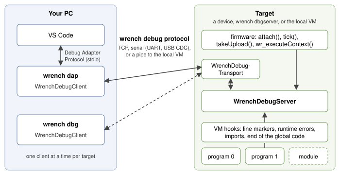

# Overview

Wrench scripts can be debugged at source level wherever they run: in a VM
on your PC, in a desktop application, or on a microcontroller over a serial
port or the network. This page shows the pieces involved and the ways to
put them together; read it first, then the page for your case.

## What you can do

* Breakpoints on any line with code, in every file of a program; a
  breakpoint on a line without code moves to the next line that has some.
* Conditional breakpoints (`n > 3 && name == "x"`), hit counts (`5`,
  `>= 10`, `% 3`) and logpoints (`value is {v}`) in VS Code.
* Watchpoints: stop when a variable, an array element or a member changes.
* Pause a running script, also inside an endless loop.
* Step in, step over, step out, also into modules the script imports.
* Call stacks with every frame in its own file and program.
* Locals and globals, with arrays, hash tables and structs expanded on
  demand.
* Changing variables: numbers and strings, in the variables view, the
  debug console or with `set` in the console debugger.
* Evaluating expressions for watches, hovers and the debug console:
  `a[2]`, `p.member`, `h["key"]`, arithmetic and comparisons.
* Stopping on runtime errors with the stack still intact, with the name of
  a missing function in the message.
* Script output (`print`, `println`, `debug::print`) in the debug console.
* Several programs at once: contexts the firmware runs side by side and
  modules loaded at run time.
* Debugging a device without the source files at hand, from the source
  embedded in its bytecode.

## The pieces



On the target side a `WrenchDebugServer` runs next to the VM. The VM calls
it at every line marker the compiler put into the bytecode, when a runtime
error happens, when a script imports a module and when the global code of
a context ends. The server is small, plain C++98, and allocates its state
once when it is created. It never runs script code: the firmware creates
its contexts, hands them to the server with `attach()`, runs them and
calls `tick()` whenever no script code runs.

The server talks to a client over a `WrenchDebugTransport`: a few
functions that move bytes over a UART, a USB serial port, a TCP connection
or, for the local VM, an in-process pipe. The bytes follow the
[wire protocol](protocol.md), which frames every message with a checksum,
so a noisy serial line recovers on its own.

On the PC side two programs act as clients. Both are modes of the `wrench`
command line tool and are built on the same `WrenchDebugClient`:

* `wrench dap` is the debug adapter that VS Code starts. VS Code talks the
  Debug Adapter Protocol to it on its standard input and output; you never
  start it yourself. See [Debugging in VS Code](vscode.md).
* `wrench dbg` is a debugger for the console. See
  [The console debugger](console.md).

A third mode, `wrench dbgserver`, turns the PC into a target: it runs a
debug server that the other two connect to, like a device would. See
[Debug targets](targets.md).

## Three ways to debug

| Where the script runs | How | Good for |
|---|---|---|
| A VM on your PC | F5 in VS Code, or `wrench dbg file.w`; the adapter runs the script in a VM of its own | script logic, before it goes near a device |
| A PC target | `wrench dbgserver` on this or another machine, connected over TCP or a serial port | trying out uploads, attach, several programs and link problems without hardware |
| A device or your application | firmware or an application with a `WrenchDebugServer`, over a UART, USB serial or TCP | the real natives, the real timing, the real data |

The local VM imitates the application a script is written for when a
[`wrench.json`](../vscode/wrench-json.md) describes it: it loads only the
libraries the application loads, and the natives it declares answer with
fixed values. Script logic can be stepped through without the application;
for its real behaviour, debug on the device or inside the application.

## Launch and attach

A debug session either launches the program or attaches to one:

| | Launch | Attach |
|---|---|---|
| VS Code | `"request": "launch"` (F5 on a `.w` file) | `"request": "attach"` |
| Console | `wrench dbg [-target T] file.w` | `wrench dbg -target T -attach [file.w]` |
| What happens | the fresh build is uploaded (unless `"upload": false`), then program 0 runs from the start | the debugger connects to what the target runs now, nothing is uploaded or restarted |
| Target needs | firmware that calls `setLaunchable( true )` and carries out what `tick()` asks for | nothing but the server |
| Program file | required | optional: without it, the program and its source are read from the target |
| Ending the session | VS Code terminates the program; `wrench dbg` terminates a local one and detaches from a remote one | detaches, the program runs on |

Launching is a request to the firmware, which owns its scripts: `tick()`
reports it, and the firmware swaps in the uploaded program and runs it. A
target whose firmware does not opt in with `setLaunchable( true )` refuses
launches and uploads, and a debugger can only attach to it. See
[Adding the debugger to your firmware](firmware.md).

## Compiling for the debugger

Only code compiled with debug information can stop. There are two levels:

| Command line | `wr_compile()` flags | What the bytecode carries |
|---|---|---|
| `wrench c -debug file.w file.bin` | `WR_INCLUDE_GLOBALS \| WR_EMBED_DEBUG_CODE` | line markers and symbol names: breakpoints, stepping, stacks, variables |
| `wrench c -debugsource file.w file.bin` | the above and `WR_EMBED_SOURCE_CODE` | also the text of every source file, so a debugger can show the code without the `.w` files |

`wrench ch` takes the same options and writes a C header instead, the
usual way to put a script into firmware:

```bash
wrench ch -debugsource script/blink.w blink.h blink
```

You do not compile anything yourself for a launch: the debugger compiles
the program with debug information and its source before it uploads it.
Compiling matters for what the firmware carries in flash, which is what an
attach debugs.

Code without debug information runs at full speed even with the server
present. With it, each source line costs one extra instruction dispatch and
a few compares while no breakpoint is set; watchpoints add a little per
line. A program compiled without debug information still runs under a
debugger, but cannot stop at breakpoints, step or be paused.

## Building wrench with the debugger

Two defines switch the debugger on:

| Define | What it builds | Where |
|---|---|---|
| `WRENCH_INCLUDE_DEBUG_CODE` | the VM hooks and `WrenchDebugServer` | targets, any compiler |
| `WRENCH_INCLUDE_DEBUG_CLIENT` | the client, the expression evaluator and the host tools | PCs (C++17, standard library), builds from `src/` only |

The Visual Studio solution `win32/wrench.sln` and the GNU makefile define
both. Firmware needs only the first, usually in a `wrench_config.h` next to
`wrench.h`; see [Build flags](../reference/build-flags.md).

The single-file build (`wrench.h` and `wrench.cpp` from a release, or
`make dist`) carries the server, the transports and the protocol, but not
the client: it leaves `debug/debug_client.h`, `debug/debug_client.cpp` and
the host tools out by design. Defining `WRENCH_INCLUDE_DEBUG_CLIENT` with it
only switches on the PC transports and the protocol code. Build host tools
from the sources in `src/`.

## Where to go next

| You want to | Read |
|---|---|
| debug a script in VS Code | [Debugging in VS Code](vscode.md) |
| debug from a terminal, or script a session | [The console debugger](console.md) |
| know exactly how breakpoints, steps, watchpoints and expressions behave | [Breakpoints, stepping and watchpoints](breakpoints.md) |
| debug programs made of several files, several programs, imported modules | [Several files, programs and modules](programs.md) |
| debug on a device, or on a PC acting as one | [Debug targets](targets.md) |
| put the debug server into your firmware or application | [Adding the debugger to your firmware](firmware.md) |
| understand what a debugger can do while a native blocks or a script yields | [Blocking code, yield and polling](blocking.md) |
| see complete cases from start to finish | [Scenarios](scenarios.md) |
| fix a session that does not work | [Troubleshooting](troubleshooting.md) |
| write your own client or server | [Wire protocol reference](protocol.md) |
