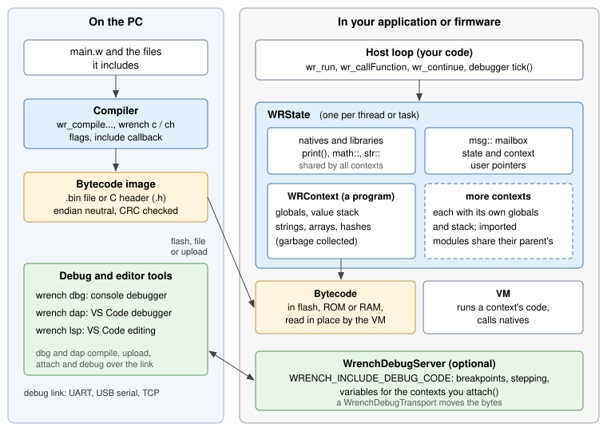

# How wrench is put together

This page names the pieces of wrench, says what each one does and where it
runs, on a PC and on a microcontroller. Read it before the quick starts: the
rest of this part of the book uses these names.

## The pieces

| Piece | What it is | Where it runs |
|---|---|---|
| Compiler | turns script source into a bytecode image | the PC, or any host with RAM to spare |
| Bytecode image | the compiled program: code, function table, optional symbols and source | a file, a C array in flash, or RAM |
| VM | the interpreter that executes bytecode | wherever the scripts run |
| `WRState` | one instance of the engine: registered natives and libraries, contexts, mailbox | your program, one per thread or task |
| `WRContext` | one loaded program: its globals, value stack and garbage collected objects | inside a state |
| Natives and libraries | C++ functions scripts call | registered in a state |
| Host loop | your code that loads programs, calls into them and does everything else | your program |
| Debug server | `WrenchDebugServer`, optional, lets a debugger control the VM | next to the VM |
| Debug tools | `wrench dbg`, `wrench dap`, `wrench lsp` | the PC |

## The compiler

The compiler reads wrench source and writes a bytecode image into a buffer
it allocates. It opens no files: the host passes the source text, and an
optional *include callback* finds the text of `include "file.w"` lines.
Flags decide what goes into the image besides the code: names of globals
(needed by `wr_getGlobalRef()`), line markers for the debugger, a copy of
the source.

The compiler is the largest part of wrench and needs far more memory than
running a program does. On small targets you compile on the PC, with the
`wrench` command line tool, and ship only the bytecode;
`WRENCH_WITHOUT_COMPILER` leaves the compiler out of the build. See
[Compiling scripts](compiling.md).

## The bytecode image

An image is a self contained, position independent block of bytes. It is
endian neutral: an image compiled on a PC runs on any target, little or big
endian, 32 or 64 bit. It ends in a checksum that also encodes the major
version, so the VM refuses an image that is damaged or was made by an
incompatible compiler (`WR_ERR_bad_bytecode_CRC`; see
[Images from other versions](compiling.md#images-from-other-versions)).

The VM reads the image in place and never writes to it, so it can live in
flash or ROM: a microcontroller runs a `const unsigned char[]` array that
`wrench ch` generated, without copying it to RAM. Several contexts can run
the same image at once. The format itself is described in
[The bytecode image](../internals/bytecode.md).

## The VM, states and contexts

A `WRState` is the engine. It holds:

* the registry of native functions, library functions and library
  constants, shared by every context of the state;
* the `msg::` mailbox, also shared;
* the list of contexts and a user pointer for your own data;
* the stack size given to each new context, the garbage collector
  threshold and the last error.

A `WRContext` is one loaded program. It has its own globals, its own value
stack (for calls, arguments and locals) and its own strings, arrays and
hash tables, which a mark and sweep garbage collector frees when nothing
refers to them any more. A context points at its bytecode, it does not copy
it.

The VM is the interpreter loop. It runs when you call into a context: to run
the global code (`wr_run()`, `wr_executeContext()`), to call one of its
functions (`wr_callFunction()`) or to resume one that yielded
(`wr_continue()`). It returns to you when the code returns, yields, or fails
with an error. Nothing runs in the background: no threads, no timers, no
interrupts. See [States, contexts and running code](running.md).

## Natives, libraries and callbacks

Scripts reach your program through functions you register:

* *Natives* (`wr_registerFunction()`) are called like any script function,
  `led( 1 )`, and get their arguments as an array of values plus a user
  pointer.
* *Library functions* (`wr_registerLibraryFunction()`) have a qualified
  name, `math::sin( x )`, and a leaner calling convention for speed. The
  standard library (`math::`, `str::`, `io::`, `msg::`...) is made of
  them; you load the parts you want.

Calls go the other way too: the host calls script functions by name, by
hash or through a pre-fetched function pointer, and a native may call back
into the script that called it. See
[Native functions and libraries](natives.md) and
[Calling script functions](calling.md).

## The host loop

wrench never takes control of your program. A typical host:

1. creates a state and registers its natives,
2. loads one or more programs and runs their global code,
3. then, in its own main loop, calls script functions when something
   happens (a timer, a message, a button) and resumes the ones that
   yielded,
4. and, with a debugger built in, calls the debug server's `tick()` while
   no script runs.

[Yield, time slices and the scheduler](scheduling.md) shows the patterns
for that loop.

## The debug pieces

Debugging is optional and costs nothing unless it is compiled in.

* `WRENCH_INCLUDE_DEBUG_CODE` builds the VM's debug hooks and the
  `WrenchDebugServer` class. The firmware creates a server, hands it the
  contexts to debug with `attach()` and calls `tick()` from its main loop.
* The server talks to the PC through a `WrenchDebugTransport`, a small
  interface with `read()`, `write()` and a clock. Ready-made transports
  cover a TCP socket and a serial port on Windows and Linux, and any Arduino
  `Stream`; for other links you write one. The protocol is framed and
  checksummed, so a noisy UART recovers on its own.
* Only code compiled with `WR_EMBED_DEBUG_CODE` (`wrench c -debug`) has the
  line markers the debugger stops on; other code runs at full speed even
  in a debug build.
* On the PC, `wrench dbg` is a console debugger, `wrench dap` is the debug
  adapter VS Code starts, and `wrench lsp` is the language server behind
  the editor features. `dbg` and `dap` can debug a local VM, or connect to a
  target over TCP or a serial port, upload a freshly compiled program and
  attach to the one it runs.

See [Adding the debugger to your firmware](../debugging/firmware.md) for the
firmware side and the [debugging overview](../debugging/overview.md) for the
rest.

## What runs where

| | Desktop application | Microcontroller |
|---|---|---|
| Compiler | in the application (`wr_compile()`), or the `wrench` tool | on the PC only (`wrench c`, `wrench ch`); `WRENCH_WITHOUT_COMPILER` on the device |
| Bytecode | compiled at load time, or read from a file | a C array in flash, a file system, or uploaded by the debugger into RAM |
| VM, state, contexts | in the application | in the firmware, usually in one task |
| Natives | your application's functions | your firmware's functions (pins, sensors, buses) |
| Debug server | optional, over TCP or a serial port | optional, over UART, USB serial or WiFi |
| Debug tools | `wrench dbg`, VS Code | `wrench dbg`, VS Code, on the PC at the other end of the link |

A desktop application can do everything in one process: compile source it
reads at run time, run it, and debug it. A microcontroller keeps only the VM
and the bytecode; everything that needs memory or a file system stays on
the PC.

The two files of the single file build, `wrench.h` and `wrench.cpp`, carry
all of it. Build flags in `wrench_config.h` or on the compiler command line
choose what is compiled in; see [Build flags](../reference/build-flags.md).
