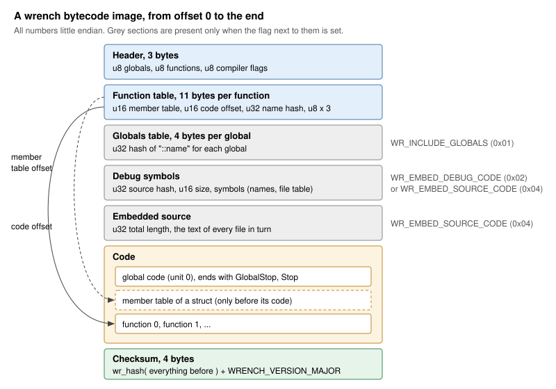

# The bytecode image

This page describes the bytecode image byte by byte: what `wrench c` and
`wr_compile()` produce and what `wr_run()` takes. You need it to write tools
that read images, to check what a flash image costs, or to understand why
an image is rejected.



The image is one block. The writer is `WRCompilationContext::link()` in
`src/cc/link.cpp`; the VM reads it in `wr_createContext()`
(`src/utils/utils.cpp`), the debug server in `readProgramInfo()`
(`src/debug/debug_server.cpp`) and the host debugger in
`WrenchDebugProgram::parse()` (`src/debug/debug_client.cpp`).

## Byte order and reading

Every number of more than one byte is stored little endian, whatever the
machine that compiled it. The VM reads the image through the macros
`READ_8_FROM_PC`, `READ_16_FROM_PC` and `READ_32_FROM_PC` (`src/vm/vm.h`):

* on a big endian target, or a little endian one without
  `WRENCH_UNALIGNED_READS`, they assemble each value byte by byte, so an
  image works at any address and alignment;
* on a little endian target with `WRENCH_UNALIGNED_READS` they read the
  value in one access, which is faster where the CPU allows it.

`wrench.h` detects the byte order from the compiler's predefined macros.
A target with special memory (code in a serial flash, for example) can
define the three macros itself before including `wrench.h`; they must
match the target's byte order. See [Build flags](../reference/build-flags.md).

This is why a program compiled once runs on every target: an image built
on a PC runs on an ESP32, an STM32 or a big endian machine unchanged.

## The header

| Offset | Size | Field |
|---|---|---|
| 0 | 1 | number of globals (at most 255) |
| 1 | 1 | number of functions, not counting the global code (at most 255) |
| 2 | 1 | the compiler flags the image was built with |

The flags byte:

| Bit | Flag | Meaning in the image |
|---|---|---|
| 0x01 | `WR_INCLUDE_GLOBALS` | the globals table is present (default; `-noglobals` clears it) |
| 0x02 | `WR_EMBED_DEBUG_CODE` | line markers in the code, debug symbols present (`-debug`) |
| 0x04 | `WR_EMBED_SOURCE_CODE` | the source is embedded, debug symbols present (`-debugsource`) |
| 0x08 | `WR_NON_STRICT_VAR` | compiled in non-strict mode (`-nostrict`); no effect at run time |
| 0x10 | `WR_READS_KEEP_VALUES` | set by every current compiler, see [Compatibility](#compatibility) |

A plain `wrench c` image has flags `0x11`, `-debug` gives `0x13`,
`-debugsource` gives `0x17`.

## The function table

Right after the header, 11 bytes for each function, in the order the
compiler met them:

| Offset in the entry | Size | Field |
|---|---|---|
| 0 | 2 | offset of the struct member table of this function, 0 when it has none |
| 2 | 2 | offset of the function's code in the image |
| 4 | 4 | hash of the function's name |
| 8 | 1 | number of parameters |
| 9 | 1 | frame space: locals beyond the parameters |
| 10 | 1 | frame base adjustment: 1 + parameters + frame space |

The offsets are 16 bit and count from the start of the image, which is
one reason a program is limited to 64 KB of code (see
[Limits](../reference/limits.md)). The VM copies the table into RAM when it
creates the context and registers every function under its name hash, so
`wr_callFunction( context, "name" )` finds it, and so does a program that
imported this one as a module.

## The globals table

Present when the flags have `WR_INCLUDE_GLOBALS`: 4 bytes for each global,
the hash of its name with `::` in front (`::count`). `wr_getGlobalRef()`
searches it; the VM skips it otherwise. `-noglobals` saves these bytes when
the host never looks up a global by name.

## The debug symbols

Present when the flags have `WR_EMBED_DEBUG_CODE` or `WR_EMBED_SOURCE_CODE`:

| Size | Field |
|---|---|
| 4 | hash of the main source text the image was compiled from |
| 2 | size of the symbols in bytes (at most 65535) |
| size | the symbols: function and variable names, then the file table |

The VM skips the section. Its contents are described in
[Debug information](debug-info.md#the-symbols-section).

## The embedded source

Present when the flags have `WR_EMBED_SOURCE_CODE`:

| Size | Field |
|---|---|
| 4 | total length of the texts |
| length | the text of every file, one after the other: the main source first, then each included file in the order of the file table |

The file table in the symbols gives the length of each file's text. The VM
skips this section too.

## The code

The code of the global code (unit 0) comes first and ends with
`GlobalStop` followed by a `Stop` byte. Every `GlobalStop` has a `Stop`
after it, also the one of a `return` in the middle of the global code:
the VM remembers where the global code stopped, and a later call of a
function from the host returns to that byte, which must stop instead of
running the rest of the global code. Then the functions follow, each at
the offset its table entry names. A function that is used as a struct
(`new S`) has its member table right before its code:

| Size | Field |
|---|---|
| 1 | number of members (the function's locals beyond its parameters) |
| 1 | number of parameters |
| 2 | number of slots in the table |
| 5 per slot | hash of a member name, then the member's index (255 for an empty slot) |

The opcodes themselves are explained in [The virtual machine](vm.md);
[Compiling, disassembling and assembling](tools.md) shows how to read them
in a listing.

## The checksum

The last 4 bytes hold `wr_hash()` of everything before them, plus the
`WRENCH_VERSION_MAJOR` of the compiler that made the image (the salt).
The bytes of `hello.bin` from the
[command line reference](../reference/cli.md), 65 in all, end in
`B3 06 FD 5C`, the checksum `0x5CFD06B3`.

The same 4 bytes identify a build of a program: the debugger compares the
checksum of the image a target runs with the one it compiled to warn that
"the target runs a different build".

## What is checked on load

`wr_newContext()` and `wr_run()` check that:

1. the block is at least 8 bytes long;
2. the checksum matches, computed byte by byte, with the salt of this
   VM's major version, or of the version before for an image without
   `WR_READS_KEEP_VALUES` (see [Compatibility](#compatibility));
3. the header and the function table fit into the block.

An image that fails any of these is rejected with `WR_ERR_bad_bytecode_CRC`
(and freed, if the call was given its ownership). `wr_isBytecodeValid()`
runs the checksum test alone; the host tools use it to tell a `.bin` from a
`.w`.

> [!WARNING]
> Nothing else is checked at load. The opcodes are only checked as they
> run: an unknown opcode stops the program with `WR_ERR_unknown_opcode`,
> but a damaged image with a matching checksum can read operands out of
> range before it gets there. Load images only from sources you trust.

## Compatibility

The checksum is salted with the major version of the compiler, so a VM
refuses images from a newer major version: a 7.x VM refuses every 8.0
image. The salt rule of an 8.0 VM (`wr_isBytecodeValid()` in
`src/utils/utils.cpp`):

| Salt | `WR_READS_KEEP_VALUES` | Result |
|---|---|---|
| 8 | any | runs, with the behaviour of 8.0 |
| 7 (`WRENCH_PREVIOUS_IMAGE_VERSION`) | not set | a 7.x image: runs with the behaviour it was compiled for |
| 7 | set | made by an unreleased build before 8.0: refused, compile it again |
| anything else | | refused |

In a 7.x image, reading a hash table key that is not there, or an
element past the end of an array or string, creates the entry or grows
the container, and reading an element or member of a value that is not
a container turns the value into one. The VM marks the context of such
an image (`WRC_IndexConverts`) and keeps that behaviour for it. Images
of 8.0 only create on assignment; see
[Arrays and hash tables](../language/containers.md) and
[Images from other versions](../embedding/compiling.md#images-from-other-versions).

Other things to keep in mind:

* Newer compilers emit opcodes older VMs do not know (`IndexCreate`,
  `StackIndexHashCreate`, the `Extended` prefix for jumps beyond 16 bits).
  Run an image on a VM at least as new as the compiler that made it.
* Debug information can be present or not; a VM built without
  `WRENCH_INCLUDE_DEBUG_CODE` skips the line markers at a small cost (see
  [Debug information](debug-info.md#what-it-costs)).

## Running from ROM

The VM does not copy the image. A context keeps a pointer to the block and
reads code, the function table, member tables and string literals from it
for as long as it runs. The block can therefore stay in flash or ROM, for
example the array of a header written by `wrench ch`:

```cpp
#include "wrench.h"
#include "blink.h" // wrench ch blink.w blink.h blink

WRState* w = wr_newState();
WRContext* context = wr_run( w, blink_bytecode, blink_bytecodeSize );
```

The block must stay valid as long as the context lives. Pass
`takeOwnership` as `true` only for a block allocated with `wr_malloc()`;
the VM then frees it with the context.

What a context needs in RAM is allocated in one piece when it is created:
the context structure, a value for each global, a copy of the function
table entry for each function, and the stack (unless the context is an
import, which shares its parent's stack). Strings, arrays, hash tables and
struct instances are allocated while the program runs and collected by the
garbage collector (see [The virtual machine](vm.md#garbage-collection)).
