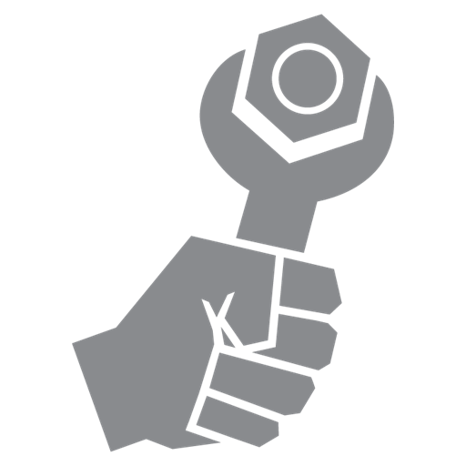

# The Wrench Book



Wrench is a small scripting language for programs that have little room to
spare: microcontrollers with a few kilobytes of RAM, firmware that wants
user programmable behaviour, and desktop applications that want a light,
fast script engine they can ship as two source files.

```wrench
// blink an LED, count the blinks, report every tenth
var count = 0;

function loop()
{
	count = count + 1;
	led( count % 2 );
	if ( count % 10 == 0 )
	{
		println( "blinked ", count, " times" );
	}
	return 500; // call me again in 500 ms
}
```

The script above is all a user writes. The firmware compiles it (or loads
it already compiled), calls `loop()` when it wants to, and gives the script
the functions it may use, here `led()` and `println()`.

## What is in this book

| Part | For you if you |
|---|---|
| [Getting started](start/what-is-wrench.md) | want to know what wrench is and try it in five minutes |
| [Language guide](language/structure.md) | write wrench scripts |
| [Standard library](library/index.md) | look up a library function |
| [Embedding wrench](embedding/architecture.md) | put wrench into an application or firmware |
| [Debugging](debugging/overview.md) | debug scripts on a PC or on the device itself |
| [VS Code extension](vscode/quick-try.md) | edit and debug wrench in Visual Studio Code |
| [Internals](internals/building.md) | build wrench, read bytecode, run the tests, contribute |
| [Reference](reference/cli.md) | look up a command, a build flag, an error code or a limit |

The parts build on each other loosely. Script authors can stop after the
language guide and the library; people embedding wrench should read
[How wrench is put together](embedding/architecture.md) first, then the
quick start for their platform.

## Conventions

Code in `wrench` blocks is wrench, `cpp` blocks are C++ for the host side.
Complete programs are shown with the output they print:

```wrench
for ( var i = 0; i < 3; ++i )
{
	print( i, " " );
}
println( "done" );
```

Output:

```text
0 1 2 done
```

Callouts mark what deserves attention:

> [!NOTE]
> Background that helps to understand a rule.

> [!WARNING]
> Something that breaks, or loses data, when it is ignored.

## Version

This book describes wrench 8.0. The project lives at
[github.com/darksimpson/wrench](https://github.com/darksimpson/wrench);
its [CHANGELIST](https://github.com/darksimpson/wrench/blob/main/CHANGELIST)
lists what changed between versions.

To read the book offline, download `wrench-book.zip` from a GitHub
release, or build it with
[mdBook](https://rust-lang.github.io/mdBook/) and open
`docs/book/out/index.html`:

```bash
mdbook build docs/book
```
